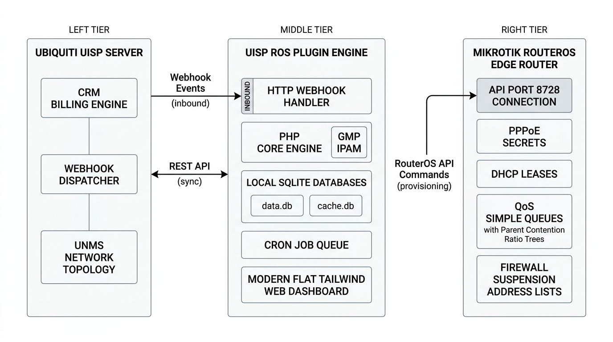
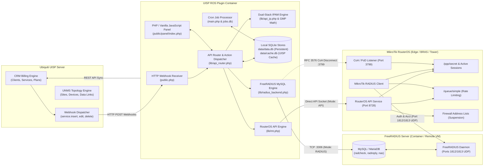

# UISP RouterOS (ROS) Plugin

Maintained by **Dev-Jack** at [JacksCodeVault/ros-plugin](https://github.com/JacksCodeVault/ros-plugin). This independent community project builds on Madalitso Mzandu's ROS plugin; it is not affiliated with or endorsed by Ubiquiti or MikroTik.

[Contributing](CONTRIBUTING.md) · [Development](docs/DEVELOPMENT.md) · [Releases](docs/RELEASING.md) · [Changelog](CHANGELOG.md) · [Support](SUPPORT.md) · [Security](SECURITY.md) · [Code of conduct](CODE_OF_CONDUCT.md)

**Licensing:** MIT terms cover Dev-Jack's original contributions. The maintainer confirms possession of the license required to publish and redistribute the inherited implementation. The included MikroTik symbol remains third-party brand artwork and is not MIT-licensed. See [Third-party notices](THIRD_PARTY_NOTICES.md).

Automated, real-time subscriber provisioning, bandwidth shaping, contention ratio management, and lifecycle synchronization between **Ubiquiti UISP** (CRM & UNMS) and **MikroTik RouterOS**.

---

## Overview

The **UISP RouterOS Plugin** bridges Ubiquiti UISP and MikroTik hardware. Instead of requiring an external RADIUS server or manual router configuration, this plugin transforms UISP CRM into an automated, real-time provisioning controller for MikroTik routers (CCRs, Cloud Routers, RB series, and CHR instances).

When subscribers are created, edited, suspended, unsuspended, or terminated in UISP CRM, the plugin intercepts these events via webhooks, performs collision-free dual-stack IP allocations (IPv4 / IPv6), and communicates directly with MikroTik devices via the native RouterOS API (port 8728).

---

## System Architecture



### End-to-End Component Flow



---

## Key Features

- **Real-Time Subscriber Provisioning**: Instantly provisions PPPoE secrets, static DHCP leases, or Hotspot accounts when services are activated in UISP.
- **Contention Ratio Management**: Automatically creates and balances parent simple queues to enforce oversubscription contention ratios (e.g. 1:5, 1:10) per service plan.
- **Granular QoS & Rate Limiting**: Enforces upload/download bandwidth limits, burst percentages, burst thresholds, burst duration, and queue priority (1-8).
- **Dual-Stack IPv4 & IPv6 IPAM**: Manages 32-bit and 128-bit subnet ranges using the PHP GNU Multiple Precision (GMP) library, preventing IP collisions across multiple routers.
- **Automated Suspension Enforcement**: Immediately throttles bandwidth, redirects to a walled-garden payment portal via firewall address lists (`disabled_list`), or switches the PPPoE profile when an invoice is overdue.
- **Instant Unsuspension**: Restores full speed and removes blocklist restrictions the moment payment is received (works seamlessly with payment gateways like M-Pesa).
- **Live Device Migration**: Changing the assigned router attribute in UISP automatically deprovisions the subscriber from the old router and recreates them on the new router without data loss.
- **Hardware Recovery & Rebuild Sync**: Repopulate an entire router with all customer accounts, profiles, and queues in minutes after hardware replacement.
- **Durable Retry Queue**: Router operations are recorded in `data/jobs.db` with immutable delete targets, bounded exponential backoff, crash recovery, and ordering that prevents replacement accounts from being deleted by stale retries.
- **Rolling Daily Backups**: Maintains a 7-day rolling rotation of SQLite database snapshots (`backup-0` to `backup-6`).
- **UISP-oriented UI**: PHP templates, vanilla JavaScript, and local CSS provide compact tables and configuration forms without a frontend build step.

---

## Technical Requirements

- **UISP / UCRM**: Version 2.14.0+ or UISP 1.3.0+ (self-hosted).
- **MikroTik RouterOS**: RouterOS v6.40+ or v7.x (Cloud Core Routers, RB series, hAP, or CHR).
- **PHP Runtime**: PHP 8.0 or later with extensions:
  - `ext-gmp` (GNU Multiple Precision math for IPv6)
  - `ext-sqlite3` (database storage)
  - `ext-curl` (REST communication)
  - `ext-json` (data serialization)
  - `ext-openssl` (verified RouterOS API TLS)
  *(All required extensions are standard inside the official UISP container).*

---

## MikroTik Router Configuration

You **do not** need a fresh or factory-reset MikroTik router. The plugin is additive — it layers subscriber accounts, queues, and leases on top of your existing configuration without modifying your firewall rules, NAT, routing tables, VLANs, bridges, or any other infrastructure you have already built.

### Prerequisites

The following must already be in place on your MikroTik before the plugin can provision subscribers:

| Prerequisite | Why |
|---|---|
| **PPPoE Server** already running on the correct interface | The plugin creates PPPoE *secrets* (user accounts), but it does not create the PPPoE server service itself |
| **DHCP Server** already running (if using DHCP mode) | Same logic — the plugin creates static *leases*, not the DHCP server |
| **IP Pool** (optional) | You can let the plugin manage IPs internally via its IPAM engine, or point PPPoE profiles at an existing MikroTik pool |
| **API service enabled** on port 8728 | The plugin communicates via the RouterOS API, not SSH or Winbox |
| **Dedicated API user** with read/write/api permissions | Security best practice — don't use `admin` |

### Setup Steps

Ensure your MikroTik router has the API service enabled and permits access from your UISP server:

### 1. Enable the RouterOS API
```routeros
/ip service enable api
/ip service set api port=8728
```

### 2. Create a Dedicated API User
```routeros
/user group add name=uisp-plugin policy=api,read,write,test,password
/user add name=uisp group=uisp-plugin password="YourSecurePasswordHere" comment="UISP ROS Plugin API"
```

### 3. Restrict API Access by IP (Firewall Recommendation)
```routeros
/ip firewall filter add chain=input protocol=tcp dst-port=8728 src-address=<UISP_SERVER_IP> action=accept comment="Allow UISP ROS Plugin"
/ip firewall filter add chain=input protocol=tcp dst-port=8728 action=drop comment="Drop other API traffic"
```

---

## Installation & Deployment

### 1. Package the Plugin Archive
Use a verified package from [GitHub Releases](https://github.com/JacksCodeVault/ros-plugin/releases), if one is available. To build from source, follow the [release guide](docs/RELEASING.md), including dependency installation, the explicit file allowlist, license checks, and archive verification. GitHub's automatically generated source ZIP does not contain installed Composer dependencies.

### 2. Upload to UISP
1. Log in to your UISP instance.
2. Navigate to **System** > **Plugins**.
3. Click **Add Plugin** and select `ros-plugin.zip`.
4. Ensure the plugin toggle is switched to **Enabled**.

For version 2.4 upgrades, complete the webhook-token and TLS migration steps in [Upgrading to 2.4](docs/UPGRADING-2.4.md).

### 3. Verify Installation
Navigate to **System** > **Plugins** > **Ros Plugin** > **Logs**. The installation hook (`hook_install.php`) will log validation of required PHP extensions and database initialization.

---

## Configuration Guide

### 1. Link Your MikroTik Router
1. In UISP, open **System** > **Plugins** > **Ros Plugin** > **Panel**.
2. Under the **Devices** tab, click **Add Device**:
   - **Router Name**: Friendly identifier (e.g. `Core-CCR2004`).
   - **Device Type**: `MikroTik RouterOS`.
   - **IP Address / Host**: LAN or WAN IP reachable by UISP.
   - **API Transport**: Plain API on port `8728`, or verified TLS (`api-ssl`, commonly port `8729`).
   - **TLS Verification**: For TLS, configure the certificate hostname and, when using a private CA, the CA file path available inside the plugin container.
   - **API Username & Password**: Credentials created in the router setup step.
   - **IPv4 / IPv6 Subnet Pool (Optional)**: Specific pool for this router (overrides global pool).
   - **Enable QoS**: Checked (creates Simple Queues).

### 2. Configure Custom Attributes in UISP
The plugin maps subscriber parameters to UISP Custom Attributes. Navigate to the **Attributes** tab in the plugin panel and click **Auto-create Attributes in UISP**. This automatically configures:

| Attribute Key | Display Name | Type | Purpose |
|---|---|---|---|
| `pppoe_user_attr` | PPPoE Username | String | Client PPPoE login name |
| `pppoe_pass_attr` | PPPoE Password | String | Client PPPoE password |
| `device_name_attr` | Router Device | String | Target MikroTik router identifier |
| `mac_addr_attr` | MAC Address | String | Client MAC address for static DHCP lease |
| `ip_addr_attr` | Static IP | String | Manual static IPv4 override |
| `ip_addr6_attr` | IPv6 Prefix | String | Assigned IPv6 prefix delegation |
| `pppoe_caller_attr` | Caller ID | String | PPPoE caller-ID lock (optional) |

### 3. Tune Plans & Contention Ratios
Under the **Plans** tab, edit QoS parameters for each UISP Service Plan:
- **Contention Ratio**: Set `1:1` for dedicated plans, or `1:5`, `1:8`, `1:10` for shared bandwidth.
- **Burst Limits**: Percentage above nominal plan speed for initial burst.
- **Burst Threshold & Duration**: Criteria to revert subscriber back to standard speed.
- **Queue Priority**: Value from `1` (highest) to `8` (lowest).

### 4. Adjust Global Settings
Under the **Settings** tab, configure global parameters:
- **Global IP Pool**: Enter CIDR ranges (e.g. `10.99.0.0/16,fd10:9900::/48`).
- **Excluded Addresses**: Gateway and infrastructure IPs to skip.
- **Suspension Address List**: Name of the firewall address list on the router (default: `disabled`).
- **Disabled Rate Limit**: Speed throttle for suspended subscribers (e.g. `128` kbps, or `0` for full block).
- **Auto-Generate Credentials**: Automatically generate secure PPPoE passwords if left empty during service creation.

---

## Subscriber Lifecycle Operations

### Creating a Subscriber
When adding a service in UISP CRM:
- For **PPPoE**: Set the `Router Device` attribute and optional username/password. The plugin creates `/ppp/secret` and `/queue/simple`.
- For **DHCP**: Set the `Router Device` and `MAC Address` attributes. The plugin creates `/ip/dhcp-server/lease` and `/queue/simple`.

### Suspending a Subscriber
When an invoice becomes overdue:
- UISP marks the service suspended.
- The plugin immediately applies the suspension policy: adds the IP to the router's `disabled_list` address list, applies `disabled_profile`, or throttles speed to `disabled_rate`.

### Unsuspending a Subscriber
When payment is received:
- UISP removes suspension.
- The plugin removes the IP from the firewall blocklist and restores full plan bandwidth.

### Router Replacement & Disaster Recovery
If a MikroTik router fails or is upgraded:
1. Connect the new router and configure basic IP and API access.
2. Update the router's IP address in the **Devices** tab.
3. In the **System** tab, click **Rebuild Local UISP Cache**.
4. The plugin will iterate through all active services mapped to that router and provision all accounts, leases, and queue trees in a single batch.

---

## FreeRADIUS Provisioning Mode (Optional)

In addition to direct RouterOS API provisioning, the plugin includes a native **FreeRADIUS provisioning engine**. This is designed for high-density environments (hundreds or thousands of active PPPoE sessions) where managing secrets directly via router sockets is inefficient or where centralized authentication across multiple BNG/BRAS routers is desired.

### Key Highlights & Flexibility

- **Per-Device Flexibility**: RADIUS mode is selected per router. You can have Core Router A using FreeRADIUS while Tower Router B uses Direct API.
- **Remote / Container Agnostic**: The FreeRADIUS server and MySQL/MariaDB database can run anywhere:
  - Inside a Docker container on the same host as UISP
  - On a separate VM or dedicated server in your NOC
  - On a managed cloud database (AWS RDS, DigitalOcean, etc.)
- **Automatic NAS Management**: The plugin automatically registers each MikroTik router into the `nas` table with the configured shared secret.
- **RFC 3576 / RFC 5176 CoA Support**: On suspension or service changes, the plugin transmits UDP Disconnect-Requests (PoD) to MikroTik port 3799 to instantly terminate active sessions.
- **1-Click Connectivity Testing**: The Settings panel provides an instant "Test Database Connection" utility that validates MySQL connectivity and schema tables directly from the UI.

---

### FreeRADIUS & MySQL Quickstart (Docker Compose)

You **do not** need to copy the entire plugin repository to your RADIUS server. The RADIUS host is completely standalone. On your target server, create a clean directory with just two files: `docker-compose.yml` and `radius_schema.sql`.

Create `docker-compose.yml`:

```yaml
services:
  radius-db:
    image: mariadb:10.11
    container_name: uisp-radius-mariadb
    restart: always
    environment:
      MYSQL_ROOT_PASSWORD: RootSecurePassword123
      MYSQL_DATABASE: radius
      MYSQL_USER: radius
      MYSQL_PASSWORD: RadiusUserPass123
    volumes:
      - ./radius-data:/var/lib/mysql
      - ./radius_schema.sql:/docker-entrypoint-initdb.d/init.sql:ro
    ports:
      - "3306:3306"

  freeradius:
    image: freeradius/freeradius-server:latest
    container_name: uisp-radius-server
    restart: always
    depends_on:
      - radius-db
    ports:
      - "1812:1812/udp"
      - "1813:1813/udp"
    environment:
      DB_HOST: radius-db
      DB_PORT: 3306
      DB_USER: radius
      DB_PASS: RadiusUserPass123
      DB_NAME: radius
```

Place `includes/radius_schema.sql` in the same directory as `radius_schema.sql`.

Start the stack:
```bash
docker compose up -d
```
MariaDB will automatically execute `radius_schema.sql` on first boot via the `/docker-entrypoint-initdb.d/` volume mount — no manual SQL imports required.

---

### Configuring the Plugin for FreeRADIUS

1. Open UISP > **Plugins** > **Ros Plugin** > **Panel** > **Settings**.
2. Scroll to **FreeRADIUS Server & Database Integration**:
   - Check **Enable FreeRADIUS Provisioning Engine**.
   - **MySQL Host**: IP or hostname of your database (e.g. `192.168.1.50` or remote domain).
   - **MySQL Port**: Default `3306`.
   - **Database Name**: Default `radius`.
   - **Username & Password**: Credentials for your MySQL user.
   - **Shared Secret**: Secret shared between MikroTik and FreeRADIUS (e.g. `testing123`).
   - **CoA Port**: Default `3799`.
3. Click **Test Database Connection** to verify reachability.
4. Click **Save Configuration**.
5. In the **Devices** tab, edit your router and set **Provisioning Mode** to **RADIUS (FreeRADIUS)**.

---

### MikroTik Router Configuration for RADIUS

Run the following commands in your MikroTik RouterOS terminal:

```routeros
# Point router to FreeRADIUS
/radius add service=ppp,hotspot address=<SERVER_IP> secret="testing123" timeout=3000ms comment="UISP FreeRADIUS"

# Enable RADIUS authentication for PPPoE / PPP
/ppp aaa set use-radius=yes accounting=yes interim-update=5m

# Enable CoA / Disconnect Requests (so suspension & speed changes apply instantly)
/radius incoming set accept=yes port=3799
```

---

### RADIUS Attribute Mapping Reference

When a subscriber connects or their status changes, the plugin manages the following attributes in the FreeRADIUS database:

| FreeRADIUS Table | Attribute | Operator | Value Example | Description |
|---|---|---|---|---|
| `radcheck` | `Cleartext-Password` | `:=` | `UserSecretPass` | Subscriber PPPoE password |
| `radcheck` | `Auth-Type` | `:=` | `Reject` | Applied when service is suspended and rate is 0 |
| `radreply` | `Framed-IP-Address` | `:=` | `10.99.1.50` | Static IPv4 assignment from IPAM |
| `radreply` | `Framed-IPv6-Prefix` | `:=` | `fd10:9900::/64` | IPv6 prefix delegation |
| `radreply` | `Mikrotik-Rate-Limit` | `:=` | `10M/20M 15M/30M ...` | Full QoS rates, burst, and queue priority |
| `radreply` | `Mikrotik-Address-List` | `:=` | `disabled` | Firewall address list for suspension |
| `radreply` | `Mikrotik-Group` | `:=` | `Plan-50Mbps` | PPP profile reference |
| `radusergroup` | `groupname` | `=` | `Plan-50Mbps` | Maps subscriber to plan group |
| `nas` | `secret` | `=` | `testing123` | Router NAS IP registration & shared secret |

---

## File Structure

```
ros-plugin/
├── composer.json               # Package definition & PHP dependencies
├── composer.lock               # Pinned dependency lockfile
├── hook_install.php            # Lifecycle installer: directory setup & extension check
├── main.php                    # Cron daemon: cache refresh & failed job retry processing
├── manifest.json               # UISP Plugin manifest & iframe menu registration
├── public.php                  # Web entry point: webhooks & UI panel router
├── .gitignore                  # Git exclusions for clean repository tracking
├── README.md                   # Complete system documentation
│
├── docs/
│   └── system_architecture.png # System architecture diagram graphic
│
├── includes/
│   ├── conf_default.json       # Default configuration seed values (including RADIUS)
│   ├── schema.sql              # Persistent database schema (data/data.db)
│   ├── radius_schema.sql       # FreeRADIUS MySQL/MariaDB standard schema
│   ├── cache.sql               # UISP cache schema (data/cache.db)
│   ├── update_schema.sql       # Versioned database migration statements
│   └── l10n/                   # Multi-language translations (en, sw, fr, es, de, pt, af)
│
├── lib/
│   ├── api_action.php          # Webhook event processing for clients & services
│   ├── api_attributes.php      # Custom attribute mapper & credential generator
│   ├── api_cache.php           # Entity cache sync engine (clients, services, plans)
│   ├── api_common.php          # Error handling, backup, and environment utilities
│   ├── api_ip.php              # Dual-stack IPv4/IPv6 IPAM engine (GMP math)
│   ├── api_jobs.php            # Fault-tolerant queue processor for retry jobs
│   ├── api_list.php            # Read handler for devices, plans, services, backups
│   ├── api_logger.php          # Operational logger writing to data/plugin.log
│   ├── api_router.php          # Central JSON API dispatcher
│   ├── api_setup.php           # DB migrations, rolling backups, and maintenance
│   ├── api_sites.php           # UNMS network topology device & link manager
│   ├── api_sqlite.php          # SQLite3 database abstraction wrapper
│   ├── api_ucrm.php            # UISP CRM REST API client
│   ├── api_update.php          # CRUD handler for devices, plans, config, and backups
│   ├── batch.php               # Batch compiler: routes to Direct API or RADIUS backend
│   ├── mt.php                  # MikroTik RouterOS API implementation
│   ├── mt_data.php             # RouterOS command builder (Queues, PPP, Leases)
│   ├── radius_backend.php      # FreeRADIUS MySQL backend & RFC 3576 CoA engine
│   └── routeros_api.class.php  # Low-level RouterOS socket API client
│
└── public/
    └── panel/                  # PHP / vanilla JavaScript admin panel
        ├── index.php           # App shell with Ubiquiti theme & navigation
        ├── assets/
        │   └── app.js          # Clean vanilla JS client (API caller, modals, toasts)
        └── pages/
            ├── devices.php     # Managed routers table with Mode column & modals
            ├── plans.php       # Plan QoS editor & contention ratio settings
            ├── services.php    # Live subscriber browser with search & filter
            ├── settings.php    # IPAM pools, FreeRADIUS config & test utility
            ├── attributes.php  # Custom attributes mapping & 1-click creation
            └── system.php      # Rolling backups, job queue & maintenance tools
```

---

## Troubleshooting & Diagnostics

- **Viewing Plugin Logs**: Open UISP > **System** > **Plugins** > **Ros Plugin** > **Logs**, or inspect `data/plugin.log`.
- **Router Connection Failures**: Verify the configured API port is reachable from the UISP host. Use port `8728` for plain API or the configured `api-ssl` port (commonly `8729`) for TLS, and ensure the dedicated API user has the required permissions.
- **Checking Failed Tasks**: In the panel, open the **System** tab and inspect the **Failed Provisioning Queue**. If jobs are present, ensure router connectivity is restored; the cron worker will process them automatically.
- **Manual Cache Reset**: Under **System** > **Maintenance**, click **Rebuild Local UISP Cache** to force-sync client and service records from UISP CRM.

---

## License

Dev-Jack's original contributions are available under the [MIT License](LICENSE). Inherited code, dependencies, and vendor artwork retain their own applicable terms. Read [Third-party notices](THIRD_PARTY_NOTICES.md) for credits and unresolved redistribution prerequisites.
